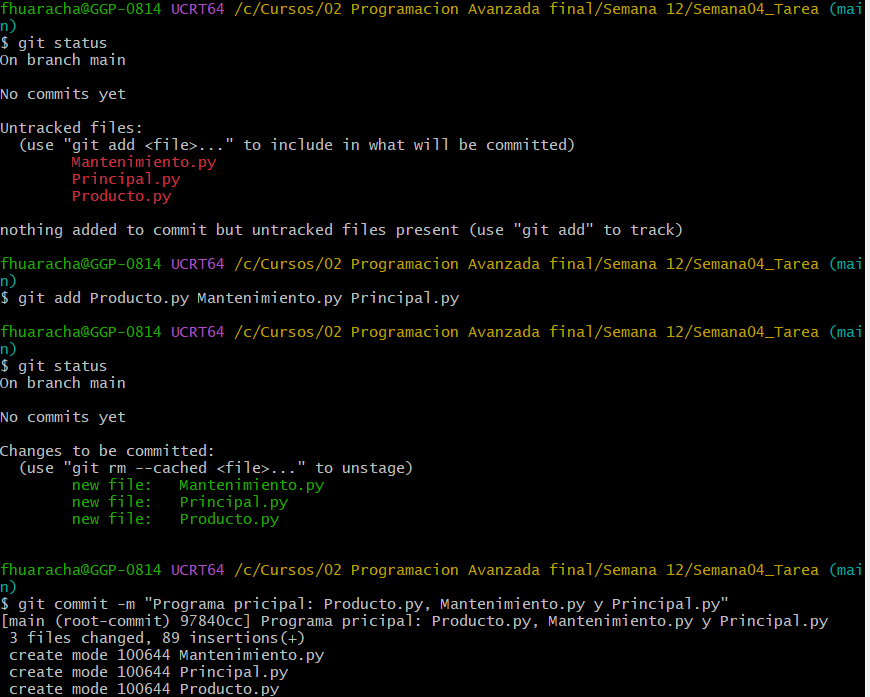
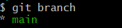
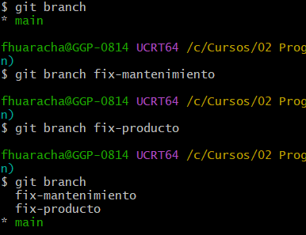

# Guia de creación y administración de ramas

> **Objetivo:** aprender a crear, cambiar, fusionar y eliminar ramas en Git, comprender cómo se relacionan con los commits y practicar los comandos en un repositorio local.
>
> **Nivel:** básico–intermedio  
> **Herramientas:** Git, terminal y Python 3 (opcional, para automatizar tareas).

---

## Indice

1. [Conceptos fundamentales](#1-conceptos-fundamentales)
2. [Preparar el repositorio](#2-preparar-el-repositorio)
3. [Consultar las ramas](#3-consultar-las-ramas)
4. [Crear una rama](#4-crear-una-rama)
5. [Cambiar de rama](#5-cambiar-de-rama)
6. [Trabajar y guardar cambios](#6-trabajar-y-guardar-cambios)
7. [Fusionar ramas](#7-fusionar-ramas)
8. [Resolver conflictos](#8-resolver-conflictos)
9. [Eliminar ramas](#9-eliminar-ramas)
10. [Ramas remotas](#10-ramas-remotas)
11. [Etiquetas y ramas](#11-etiquetas-y-ramas)
12. [Problemas frecuentes](#14-problemas-frecuentes)
13. [Práctica propuesta](#15-práctica-propuesta)

---

## 1. Conceptos fundamentales

Una **rama** (*branch*) permite desarrollar una funcion, corregir un error o experimentar sin trabajar directamente sobre la rama principal.
Como ejemplo se tiene el siguiente esquema de un proyecto en python sobre una conexion a una base de datos:

- `main` (*master* en versiones antiguas): rama principal habitual del proyecto.
- `rama-funcion/...`: rama para desarrollar una funcionalidad.
- `fix-mantenimiento/...`: rama para corregir el error de conexion.
- `fix-producto/...`: rama para correguir la clase producto.

Cuando se crea un commit en una rama, su referencia avanza a ese nuevo commit. Otras ramas mantienen sus propias referencias.

### Archivos de ejemplo

| Archivo | Que hace |
|---------|----------|
| Principal.py | Contiene el menu para consultar, agregar y eliminar productos |
| Producto.py | Contiene la clase Producto con todos sus atributos |
| Manenimiento.py | Contine la clase Mantenimiento, con metodos de conexion a la base de datos, consultar, insertar y eleminar registros |


### Esquema conceptual

```text
A---B---C  main
    |\
    | D  fix-mantenimiento
    |
     \
      E  fix-producto
```

En este ejemplo, `fix-mantenimiento` y `fix-producto` parte del commit `B` y tiene dos commits adicionales (`D` y `E` respectivamente). La rama `main` no incorpora esos commits automáticamente.

> **Importante:** una rama no es una copia completa e independiente de todos los archivos. Es una referencia dentro del historial de Git; al cambiar de rama, Git actualiza el directorio de trabajo según el commit correspondiente.

---

## 2. Preparar el repositorio
Desde la terminal de tu editor de codigo, abre la terminal y comprueba que Git este instalado:

```bash
git --version
```

Configura tu identidad si aun no lo has hecho:

```bash
git config --global user.name "Francisco Huaracha"
git config --global user.email "francisco.huaracha@tecsup.edu.pe"
```

Compruebar que quedo guardado:

```bash
git config --global --list
```

Crea una carpeta e inicializa el repositorio:

```bash
mkdir Semana04_Tarea
cd Semana04_Tarea
git init
```

**Qué hace cada comando:**

- `mkdir`: crea la carpeta del proyecto.
- `cd`: entra en la carpeta.
- `git init`: inicializa un repositorio.

Crea tus archivos, por ejemplo:

**Mantenimiento.py**
```python
import pymysql

class Mantenimiento:
    
    def __init__(self):
        self.conexion=pymysql.connect(host="127.0.0.1", port=3306, user="root", password="root", database="mibasededatos")
        self.cursor=self.conexion.cursor()
        print("Conexion establecida correctamente")
```
**Producto.py**
```python
class Producto:
    def __init__(self,Codigo,Nombre,Descripcion,Precio_costo,Precio_venta,Stock):
        pass
```

Registra el primer commit

```bash
git add Producto.py Mantenimiento.py Principal.py
git commit -m "Programa pricipal: Producto.py, Mantenimiento.py y Principal.py"
```

- `git add`: prepara los cambios para el siguiente commit.
- `git commit -m`: registra los cambios preparados con un mensaje descriptivo.

Comprueba el estado:

```bash
git status
git log --oneline
```



*Figura 1. Inicialización y primer commit.*

---

## 3. Consultar las ramas

Lista las ramas locales:

```bash
git branch
```

La rama activa se identifica con un asterisco (`*`).




*Figura 2. Resultado de `git branch`.*

---

## 4. Crear una rama

```bash
git branch fix-mantenimiento
git branch fix-producto
```

- `git branch`: crea una rama a partir de la rama actual.



*Figura 3. Ramas creadas. La rama activa aparece marcada con `*`.*

---

## 5. Cambiar de rama

Para pasar a una rama existente:

```bash
git switch fix-producto
git switch main
```

Git puede impedir el cambio si existen modificaciones locales que se perderían o entrarían en conflicto con los archivos de destino. Antes de cambiar de rama, revisa:

```bash
git status
```

---


### Avance de la guia

- [X] 1. [Conceptos fundamentales](#1-conceptos-fundamentales)
- [X] 2. [Preparar el repositorio](#2-preparar-el-repositorio)
- [X] 3. [Consultar las ramas](#3-consultar-las-ramas)
- [X] 4. [Crear una rama](#4-crear-una-rama)
- [X] 5. [Cambiar de rama](#5-cambiar-de-rama)
- [ ] 6. [Trabajar y guardar cambios]
- [ ] 7. [Fusionar ramas]
- [ ] 8. [Resolver conflictos]
- [ ] 9. [Eliminar ramas]
- [ ] 10. [Ramas remotas]
- [ ] 11. [Etiquetas y ramas]
- [ ] 12. [Problemas frecuentes]
- [ ] 13. [Práctica propuesta]

### Enlaces
- [Mi perfil de GitHub](https://github.com/francisco1tecsup)